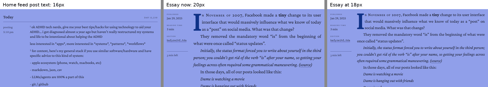
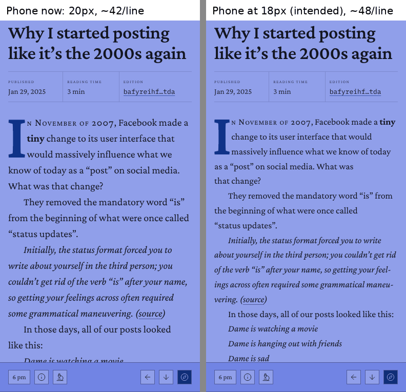
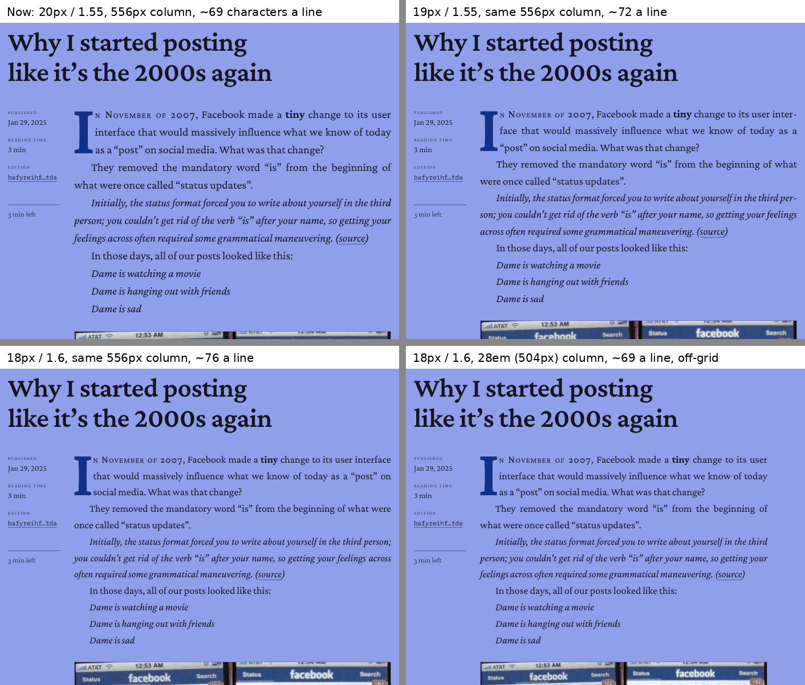

# dame.is typography audit

*Taken 30 October 2026 against `main` at `9dd272b`, which includes the column grid from #363. Rendered sizes, line lengths and screenshots come from the live site in Chromium (Playwright) at widths from 390 to 2560px; code references are to this repository. The recommendations were then built; see [As built](#as-built) at the end.*

*Interactive mock-ups of every option below, set on the grid with live line-length readouts, are in a private artifact shared in the session that produced this audit.*

## Summary

Essays are set at 20px. Everything else a visitor reads at any length is set at 16px: post text in the feeds, the About bio, the résumé summary. That 1.25× step is the jump between the blog and the rest of the site, and nothing sits between the two sizes to soften it. A 48px title sits above the essay text and 11 to 14px labels sit beside it.

What I'd change, in order:

1. **Set essays at 18px at every width**, with 1.6 leading. 18px is `--text-lg`, the scale's next step above body, and the size page intros already use. In the grid's text column it gives about 76 characters a line, at the top of the usual range. 19px is the fallback if that reads long (about 72).
2. **Fix the bug that gives phones 20px essays.** The 18px phone rule in `LeafletDocument.css` has never applied, because of where component CSS lands in the bundle.
3. **Put a role layer between the size scale and the components** (`--type-reading`, `--type-body`, `--type-caption` and so on), and gather the long-form surfaces under one reading context. Reading text currently comes in four sizes set in four places.
4. **Make the display sizes fluid with `clamp()`** so titles grow with the window instead of jumping at 700px, and stop growing at 1028px, where the grid gains its first wing columns. Keep body text fixed.
5. Optionally, **let readers choose an essay size** (18, 20 or 22px) with the same `<html>` data-attribute pattern the font and paper modes use.

Items 1, 2 and 4 are small CSS changes. Item 3 is most of the work, and it is what makes the system easy to retune later.

## How this was measured

- **Size share per page.** Every visible text node inside `.main`, grouped by computed `font-size` and weighted by character count. This says what size a page actually reads at, rather than what the stylesheet offers.
- **Characters per line.** For the first 20 to 25 body paragraphs of two essays ("Why I started posting like it's the 2000s again" and "Creating a decentralized bathroom"), each character's rendered line was found with a DOM `Range`. Letters and spaces are both counted, as in Bringhurst's 45 to 75 range with 66 as the ideal. Each paragraph's last line and any line under 13 characters are excluded.
- **Alternatives.** Each candidate size was injected as CSS into the live essay page and measured the same way.
- **x-height.** Measured from the loaded fonts with canvas `measureText`: Crimson Pro 0.42em, Georgia 0.46em, Chromium's default sans 0.53em.
- **Code inventory.** `grep` across `src/**/*.css`.

Measurements were taken at the 6 pm sky hour; the theme does not affect type metrics. Two essays is a small sample for line-length medians, so treat ±2 characters as noise.

## What's there now

### The scale (`src/styles/theme.css`)

| Token | Size | Crimson x-height | `font-size` declarations using it |
| --- | --- | --- | --- |
| `--text-2xs` | 11px | 4.6px | 10 |
| `--text-xs` | 12px | 5.0px | 199 |
| `--text-meta` | 13px | 5.5px | 70 |
| `--text-sm` | 14px | 5.9px | 207 |
| `--text-base` | 16px | 6.7px | 48 |
| `--text-lg` | 18px | 7.6px | 55 |
| `--text-prose` | 20px | 8.4px | 1 (essays only; not a step on the scale) |
| `--text-xl` | 22px | 9.2px | 25 |
| `--text-2xl` | 28px | | 12 |
| `--text-3xl` | 36px | | 8 |
| `--text-4xl` | 48px | | 2 |

The token discipline is good: 638 of the 764 `font-size` declarations (84%) use a token, and most of the 72 raw values sit in files already on stylelint's `LEGACY_TYPE` list. Usage is weighted to the small end: 486 of the 638 token uses (76%) are below body size.

### Where the reading sizes come from

| Surface | Size | Leading | Set in |
| --- | --- | --- | --- |
| Essays and works (`.leaflet-doc`) | 20px | 1.55 | `LeafletDocument.css:5-6` via `--text-prose` |
| Legacy markdown (`.blog-prose`) | 16.8px | 1.6 | `Blogging.css:369` (raw `1.05rem`) |
| Résumé summary | 16px | 1.6 | `Resume.css:112` overrides `.blog-prose` |
| About bio, feed post text | 16px | 1.6 and 1.3 | `--text-base` |
| Page intros | 18px | 1.6 | `app.css:151`, `--text-lg` |

Measured share of characters by size, 1440px wide:

| Page | Largest shares |
| --- | --- |
| `/posting` | 16px 62%, 14px 31% |
| `/` (home) | 14px 50% (mostly quoted posts), 16px 39% |
| `/available` (résumé) | 14px 72% (highlights, skills), 16px 18% |
| An essay | 20px 72%, 16px 18% |

So the site's main reading size is 16px, with 14px for secondary text such as quoted posts and résumé highlights. Essays are the one place text runs larger.

### Line length is now fixed by the grid

Since #363, `--measure` and `--measure-prose` both resolve to `--text`: five grid columns, 34.75rem, which is 556px. The column is in `rem`, so it no longer follows the essay's type size; only the type size changes how many characters fit. The grid was built around the 20px decision. The comment at `theme.css:89` says the text column is "27.8em at the 20px essay size, the old 28em measure". Any change to essay size has to be weighed against this column.

## Findings

### 1. Essays read 1.25× larger than the rest of the site

At every width from 768 to 2560px the essay body is 20px on 31px leading, in the 556px column, at a median of 69 characters a line. Post text in the feeds is 16px.



There is a nuance here. Crimson Pro's x-height (0.42em) is small, so 20px Crimson has the same x-height as about 18.3px of Georgia. On its own terms 20px is not large for this face. It looks large because it sits next to 16px Crimson. That leaves two ways to close the gap: bring the essays down, or bring the rest up. Raising `--text-base` would touch 48 declarations, every feed and the ledger's tuned layout. Lowering the essays touches one token. I'd lower the essays.

### 2. Phones get 20px essays because of a cascade-order bug

`LeafletDocument.css:13-17` sets `:root { --text-prose: 1.125rem }` under `max-width: 700px`, so phones should get 18px. They get 20px.

The cause is bundle order. `App.jsx:6` imports `lib/pageStyles.js`, which imports `LeafletDocument.css`, and `main.jsx` imports `App.jsx` (line 7) before the global sheets (lines 13 to 19). In the built stylesheet, the phone rule lands at byte 98,273 and theme.css's `:root, [data-theme='light']` rule at byte 293,344. Both selectors have the same specificity, so the later one wins at every width.

The order is deliberate (`pageStyles.js` explains why), so the fix belongs on the token side, not in the import order. The other two bare `:root` blocks in component sheets (`ChromeBar.css:17`, `Xray.css:11`) define only their own variables, so this is the only one that collides today.

At 390px the essay currently runs a median of 42 characters a line, below the usual 45 floor. At the intended 18px it runs 47 to 48.



### 3. Nothing changes size between breakpoints

No `font-size` in `src` uses `clamp()`, `vw` or container units. Responsive type is a set of media-query swaps, and the titles show the cost. The page title is 48px from 701px up and 36px below. That kind of one-step drop at 700px is written separately for three titles (`app.css:465`, `Resume.css:33`, `Blogging.css:502`). A 768px tablet gets the same 48px title as a 2560px monitor.

For body text, staying fixed is correct. Reading distance doesn't change with window width, and #363 already gives wide windows extra columns for figures rather than wider text. Fluid sizing is only worth adding at the display end.

### 4. Long-form text has four sizes and repeated selector lists

Essays are 20px, legacy markdown 16.8px, and the résumé summary and About bio 16px. The book treatments are attached by listing selectors. The drop cap rule names five (`typography.css:187` and again at `:231`), and the oldstyle figures rule names three (`typography.css:277`). A new long-form surface, such as the newsletter page from #361, has to be added to each list by hand, and its size is whatever its own sheet sets.

### 5. The small end of the scale is crowded

11, 12, 13 and 14px are four steps within 3px, at ratios of 1.08 to 1.09 between neighbours. In Crimson those are x-heights of 4.6, 5.0, 5.5 and 5.9px, and three quarters of all token uses sit there. At a glance, `--text-meta` and `--text-sm`, or `--text-2xs` and `--text-xs`, hardly read as separate sizes. The design audit's TYP-05 already proposes a label change (real capitals at 11px, weight 500), held on `/colophon` for your review. That decision should come first; after it, meta and sm may be able to merge. I haven't checked every page where these sizes appear, so this is a direction, not a finding with a fix.

### 6. Line-height has two tokens and eighteen raw values

`--leading` (1.6) and `--leading-tight` (1.3) appear in 6 and 26 declarations. About 140 others use raw numbers: 1 (28 times), 1.2 (20), 1.5 (13), 1.25 (10), 1.3, 1.35 and 1.4 (9 each), 1.1 and 1.45 (8 each), and nine more. Essays use 1.55 and the feed's post text 1.3.

### 7. Components ask for sizes, not roles

`--text-sm` appears in 207 declarations and `--text-xs` in 199. Depending on the file, each means a caption, metadata, a label or control text. To make captions one step larger, someone would first have to work out which of the 207 are captions. Scoped overrides already work here (`adminShell.css:279` for the admin, `Resume.css:461` for résumé print), but they can only shift whole steps, not one role.

## Recommendations

### R1. Set essays at 18px at every width

| Setting | Column | Median characters a line (10th to 90th percentile) | On the grid |
| --- | --- | --- | --- |
| 20px / 1.55 (now) | 556px | 69 (61 to 74) | yes |
| 19px / 1.55 | 556px | 71 to 73 (64 to 77) | yes |
| **18px / 1.6** | 556px | 76 (67 to 82) | yes |
| 18px / 1.6, `28em` measure | 504px | 68 to 70 (61 to 74) | no |
| Phone, 20px (now) | 358px | 42 (36 to 47) | |
| Phone, 18px | 358px | 47 to 48 (41 to 51) | |



Why 18px rather than 19px:

- It is a step that already exists (`--text-lg`), so `--text-prose` stops being an off-scale value.
- It matches the page intros, which are the site's other lead text.
- It is the right size on a phone too, so there is one essay size and the broken phone rule can simply be deleted.

The cost is line length. 76 characters is at the top of the 45 to 75 range. Justified text copes with long lines better than short ones, because each line has more word spaces to share out the slack, and the extra leading (1.6 instead of 1.55) helps the eye find the next line. If it still reads long once you see it on a real screen, 19px keeps every edge on the grid at about 72 a line. I'd try that before the `28em` measure, which puts the text's right edge between grid lines.

A third route, which I wouldn't take now: retune the grid so five columns equal 28em at 18px. That means a 5.1rem column instead of 5.75rem, and the type area would shrink from 42rem to about 38rem, moving everything #363 just aligned.

The change itself:

```css
/* theme.css */
--text-prose: var(--text-lg);

/* LeafletDocument.css: delete the max-width: 700px :root block (lines 13-17),
   and set .leaflet-doc's line-height to 1.6 */
```

Two things to re-check afterwards, because both were tuned at 20px:

- **Justification and hyphenation.** The `word-spacing` and `hyphenate-limit-chars` values in `LeafletDocument.css:56-63` came from measurements at the essay size.
- **Keeping the last two words together.** The `glueLastWords` behaviour already leaves short lines on a phone at 18px: "What was / that change?" in the phone screenshot above.

### R2. Keep tokens and their responsive values in theme.css

If R1 goes in, the broken rule is deleted. Either way, the rule going forward should be:

- A component sheet never assigns a global token on a bare `:root`.
- A token's responsive values sit next to the token, as the phone block for `--edge` already does at `theme.css:196`.
- Scoped overrides on a class or attribute (`.wb`, `.resume`, `:root[data-…]`) are fine, because they don't tie with theme.css's `:root`.

If you keep the two sizes instead, the fix is to move the phone value into theme.css's existing `@media (max-width: 700px) { :root { … } }` block.

To guard it, stylelint's core rules can't express "a property defined in another file". A small vitest check in the style of `pageStyles.test.js` can: read the custom property names theme.css defines, then fail if any sheet outside `src/styles/` assigns one inside a bare `:root` rule.

### R3. Three layers: steps, roles, contexts

- **Steps** stay as they are in theme.css: the `--text-*` scale, with R4's fluid display steps.
- **Roles** are new tokens in theme.css that name what text is for and point at a step. Components use roles.
- **Contexts** are scopes such as the admin's `.wb`, résumé print and the reading context in R4 below, which change roles for everything inside them.

```css
/* theme.css: roles. A component asks for a role; the role picks a step. */
:root {
  --type-reading: var(--text-lg);   /* essays, works, long-form pages, page intros */
  --type-body: var(--text-base);    /* posts, UI copy */
  --type-caption: var(--text-sm);   /* figure captions, credits, hints */
  --type-meta: var(--text-meta);    /* ledger verbs and times, facts */
  --type-label: var(--text-xs);     /* small-caps labels, eyebrows */
  --type-title: var(--text-4xl);    /* page titles */
}
```

Start with the roles as plain aliases, so nothing renders differently. Move files over as they're touched, the way the `LEGACY_TYPE` list in `stylelint.config.js` is worked down. Once captions read `--type-caption` everywhere, making them larger is a one-line change.

### R4. One reading context for long-form documents

A `.reading` class, applied by `LeafletDocument` (so every essay, work and `site.standard.document` gets it) and by the other long-form surfaces (the About long-form, the résumé summary, the newsletter page). It owns the reading setting in one place:

```css
.reading {
  font-size: var(--type-reading);
  line-height: var(--leading-reading, 1.6);
  font-variant-numeric: oldstyle-nums proportional-nums;
}

/* Headings in em, so the whole ladder follows the reading size. */
.reading h2 { font-size: 1.5em; }                      /* 27px at 18px */
.reading h3 { font-size: 1.2em; font-style: italic; }  /* 21.6px */
.reading :is(h4, h5, h6) { font-size: 1em; }
```

The selector lists in `typography.css` (drop caps, oldstyle figures, lining figures in headings) then become `.reading`, with a modifier where a surface wants less. The résumé summary might keep its drop cap but not justification, for example. With headings in em, R6 below works without any extra rules.

Whether the About bio and résumé summary should move up to 18px is your call. They are long-form, but they also sit among UI text.

### R5. Fluid display sizes

```css
/* theme.css */
--text-4xl: clamp(2.25rem, 1.792rem + 1.881vw, 3rem);   /* 36px at 390px, 48px from 1028px */
--text-3xl: clamp(1.75rem, 1.444rem + 1.254vw, 2.25rem); /* 28px at 390px, 36px from 1028px */
```

This reproduces today's phone and desktop sizes at either end and fills in the range between. The top end is set to 1028px on purpose: that is the narrowest window where #363's grid adds wing columns (`theme.css`, the `--wing` rule). Below it the title grows into the window; above it the title holds and the grid takes the extra room, as figures and galleries already do. The three phone overrides (`app.css:465`, `Resume.css:33`, `Blogging.css:502`) can then be deleted, since each one steps down the scale exactly as the clamp does on its own. Résumé print sets its own 3xl and 4xl values (`Resume.css:467-468`), which still win inside `.resume`.

Keep `--text-2xl` and below fixed. The text column is fixed in rem, so a fluid body size would change the number of characters per line with the window width.

A `vw` term alone doesn't grow with browser zoom. A `rem` term and `rem` bounds inside the `clamp()` keep zoom working, but it should still be checked at 200% zoom.

### R6. Optional: a reader's choice of essay size

The font mode (`useFont.jsx`, `data-font`) and paper mode (`usePaper.jsx`, `data-paper`) already put a reader preference on `<html>` and restore it before paint. An essay size could work the same way:

```css
:root[data-reading-size='large']  { --type-reading: 1.25rem; }  /* 20px */
:root[data-reading-size='larger'] { --type-reading: 1.375rem; } /* 22px */
```

`:root[…]` outranks theme.css's `:root`, so this works from any sheet. Because the column is fixed, each option changes line length: 18px gives 76 characters a line and 20px gives 69 (both measured), and 22px should give about 63 (estimated in proportion). Anything smaller than 18px would run past 80, so the choices should only go up from the default. Readers who like today's 20px setting would keep it. Where the control lives (the reading marker, or beside the font toggle) is a design call.

### R7. Leading tokens

A proposal that covers most of the raw values. Each fold is a small visual change, so it should go file by file:

| Token | Value | Takes over |
| --- | --- | --- |
| `--leading-solid` | 1 | labels, figures, ornaments (28 uses) |
| `--leading-display` | 1.1 | page titles (8) |
| `--leading-heading` | 1.2 | headings (20) |
| `--leading-tight` | 1.3 | existing; the ledger's post text (9 raw, 26 token) |
| `--leading-ui` | 1.45 | captions, hints, cards: 1.4, 1.45, 1.5 (30) |
| `--leading` | 1.6 | reading text |

The 1.25 and 1.35 values (19 uses) need a look case by case. Once migrated, `line-height` can join `font-size` in stylelint's allowed-value list.

## Suggested order

1. **R1 and R2 together.** One small PR: essays at 18px, the phone rule deleted, leading 1.6. Then re-check hyphenation and last-word gluing at 390 and 1440px.
2. **R5.** Fluid 4xl and 3xl, and the three phone overrides deleted.
3. **R3 and R4.** Roles as aliases first, then the `.reading` context, then the selector lists in `typography.css`.
4. **R7**, file by file.
5. **R6**, if wanted.

## Open questions

- **18px or 19px?** Worth comparing both on a real essay on your own screens; the screenshots here are at 1× pixel density.
- **The essay title.** With 18px body text, the 48px title is 2.67 times the text instead of 2.4. It may want to step down on essays (to 40px, say); judge after R1.
- **The About bio and résumé summary.** Should they take the reading size (18px) or stay at body size?
- **TYP-05.** The label decision comes before any merging at the small end of the scale (finding 5).

## As built

Built on `claude/festive-edison-244lxy` on 30 October 2026, taking the recommended answer to each question. The type is set out on `/colophon` under **Type**: the roles and where each lives on the grid, the reading setting with its measured line length, the scale, the leading tokens and the rules. Every size there is read back from the page as it renders.

**What changed**

- **Essays at 18px on 1.6, at every width** (R1). Long-form now has one setting: a `.reading` context in `typography.css`, using `--type-reading` (`--text-lg`) and `--leading-reading`. LeafletDocument puts it on every document it renders, and the document skeleton wears it too, so its placeholder lines match the text's. `--text-prose` is gone. Legacy markdown long-form (`.blog-prose`: older works, `/sharing`, About's legacy body) moved from a raw 16.8px to the same size.
- **The phone bug is fixed by deletion** (R2). The `:root` rule in `LeafletDocument.css` is removed. `src/styles/tokens.test.js` fails if any stylesheet outside `src/styles/` sets a theme token on a bare `:root`; run against the old file, it reports `--text-prose`.
- **Roles and leading tokens** (R3, R7) are in `theme.css`. The roles are `--type-title`, `--type-reading`, `--type-body`, `--type-caption`, `--type-meta` and `--type-label`. The leading tokens are `--leading-reading`, `--leading-ui`, `--leading-heading`, `--leading-display` and `--leading-solid`, next to the existing two. The files this change touched use them; the rest of the stylesheets are untouched (see below).
- **The heading ladder is in em** (R4): h2 is 1.5em (27px) and h3 is 1.2em in italic (21.6px). In print the same ladder lands at 17.25pt and 13.8pt over the 11.5pt text, with no print rule of its own.
- **Titles are fluid through the role** (R5): `--type-title` grows from 36px on a 390px phone to 48px at 1028px, then holds. `.page-title` (and with it the home hero and every page title) and `.resume-title` use it, and their phone swaps are gone. Print pins the role back to 48px.

**Where this departs from the recommendations**

- **The fluid size lives on the title role, not the 3xl and 4xl steps.** Making the steps fluid would also have shrunk Ratioed's figures, the About heading and the generic `h1` on phones. Record titles (`.record-title`) keep their own 3xl-to-2xl swap.
- **The leading tokens and roles weren't migrated across every stylesheet.** Folding about 140 raw values in some 40 files would conflict with a lot of in-flight work for no visual change, so new and touched code uses them and the rest can move as it is edited. The `/colophon` rules say so.
- **No reader size setting** (R6 dropped). Everything is in rem, so browser zoom and a reader's default font size already scale type and grid together. At a 20px default, an essay's column grows to 695px and still holds 76 characters a line.
- **The open questions, answered.** The size is 18px, not 19. The essay title stays at the shared 48px, so titles keep one size across routes. The About bio and the résumé summary stay at body size, since they sit among interface text; About's long-form body, a document, reads at 18px. TYP-05 is untouched.

**Roles resolve on `:root`.** A scope that re-sizes steps (the admin's `.wb`, résumé print) doesn't reach a role, so such a scope has to set the role it relies on as well. That's also why reading has its own leading token: the admin's `.wb` tightens `--leading` to 1.45, and the editor's document preview should still match the published page. It does: 18px on 28.8px.

**How it was checked**

On a local build with live data and the clock pinned to 1 pm Eastern, ten page types (two essays, the long guide, a work, Ratioed, home, the blog index, About, the résumé, /posting) were captured at 390, 768, 1024, 1440 and 1920px, before and after. Each page also had its type measured.

| | Before | After |
| --- | --- | --- |
| Essay text, phone | 20px, 42–43 a line | 18px, 47–49 a line |
| Essay text, desk | 20px, 68–70 a line | 18px, 76 a line |
| Page title at 390 / 768 / 1024 / 1440px | 36 / 48 / 48 / 48px | 36 / 43.1 / 47.9 / 48px |
| Section heads h2 / h3 / h4 | 28 / 22 / 20px | 27 / 21.6 / 18px |
| Loose justified lines (average space over twice a normal one), five documents | 6.7% | 5.9% |
| Sideways overflow, any page or width | none | none |

The justification and hyphenation settings were left as they were; at the longer line they did slightly better on average, though individual documents moved both ways. Also checked:

- **A 20px default font size:** type and grid scale together and lines still hold 76 characters.
- **200% zoom on a 1440px window** (a 720px viewport at 2×): no overflow, 71–72 a line.
- **A 320px reflow:** no overflow.
- **Print:** 11.5pt text, 17.25pt and 13.8pt heads, a 48px title, and an unchanged résumé.
- **The loading skeleton at both widths:** each placeholder line is one 28.8px text line.
- **The admin's document preview:** matches the published setting.
- **`/colophon`** through the harness, at 1440 and 390px.
- **Tests and lint:** 2,771 tests, ESLint, stylelint and a production build all pass.

Firefox wasn't available in the test environment, so its drop-cap fallback (the float in `typography.css`) wasn't re-measured at 18px. It is set in em and was tuned at 16 and 16.8px, so it should hold, but it's worth one look.

